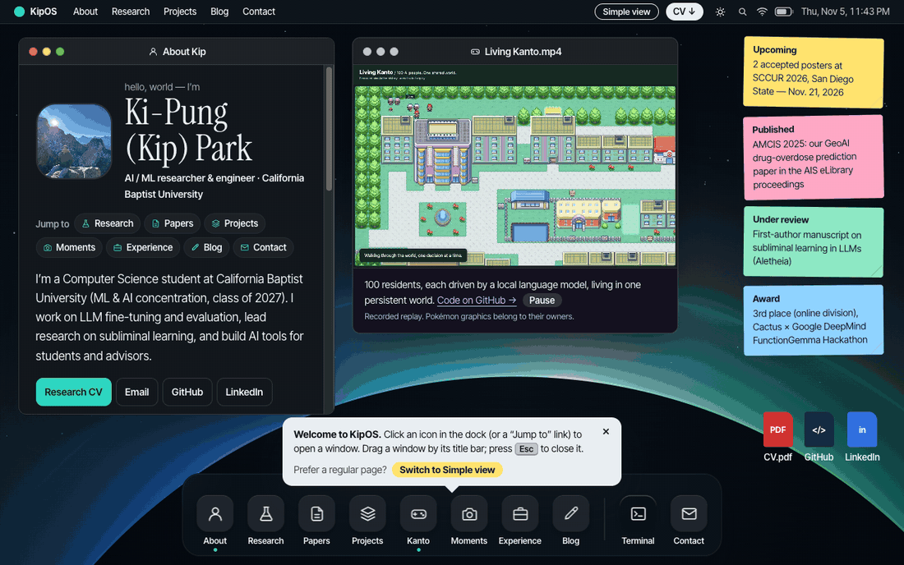

# kipung.github.io

Live at **[kipung.github.io](https://kipung.github.io)**.

This repo holds the built output of my Astro portfolio, a desktop-style site ("KipOS") with windows, a dock, and a simple-view fallback. It is generated, so edit the source project and rebuild instead of changing files here.

